# Panel findings before-and-after screenshots

The `before` images are screenshots extracted from the supplied `after defense comments of panel.docx`. The `after` images are captures of the updated local app on November 17, 2026.

| Finding | Before | After |
| --- | --- | --- |
| Guest registration consent | 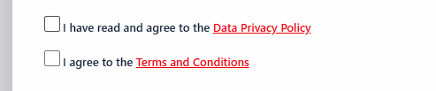 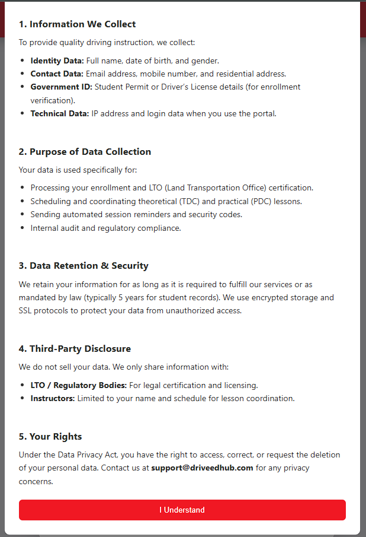 | 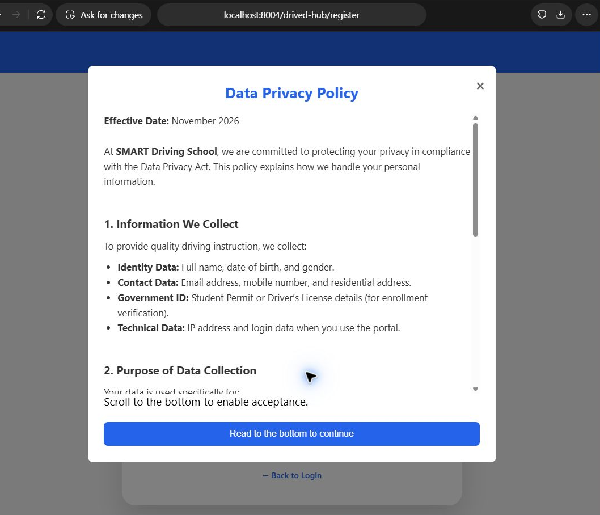 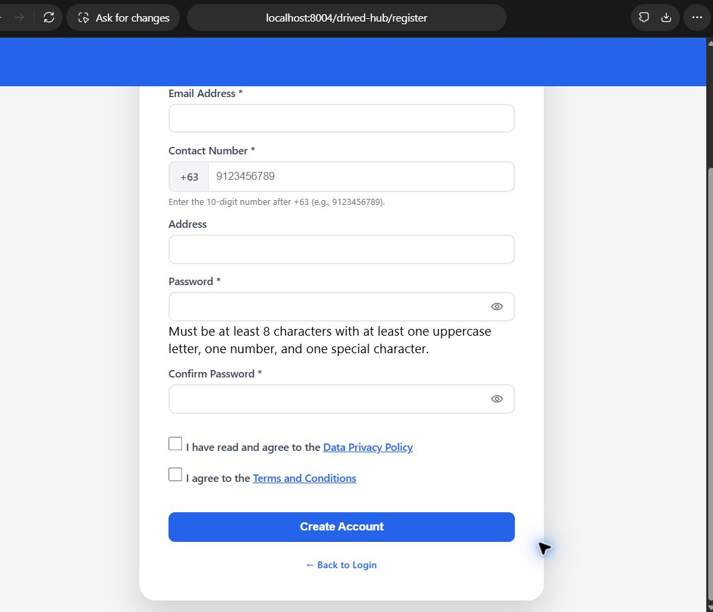 |
| Instructor session logging | 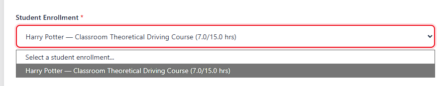 | 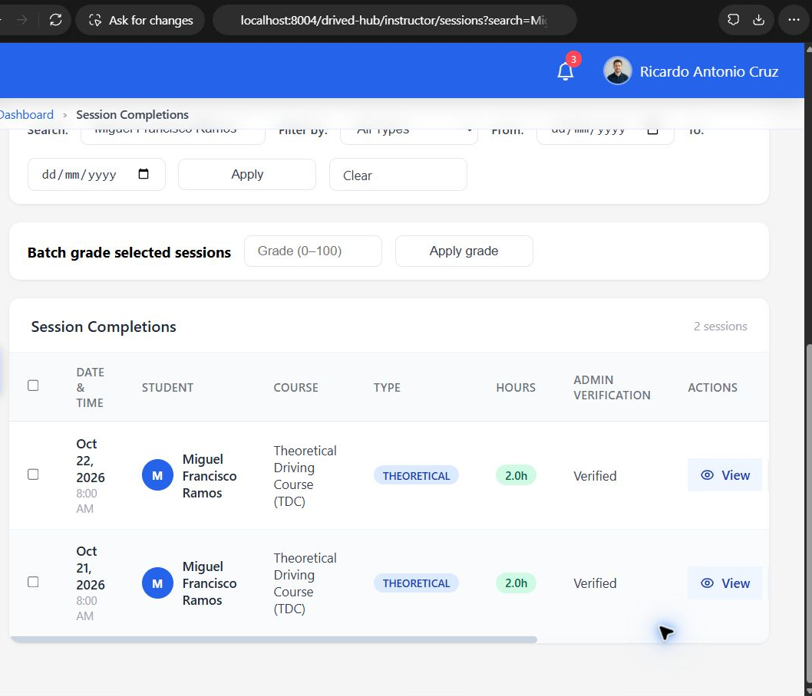 |
| Branch on course enrollment | 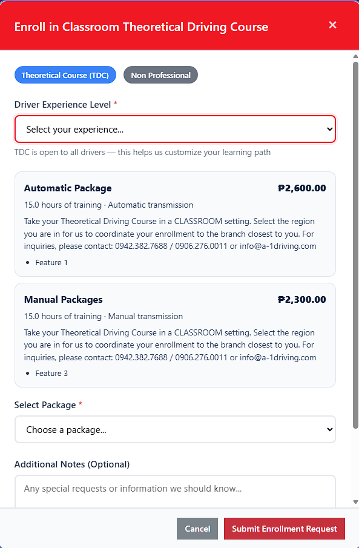 | 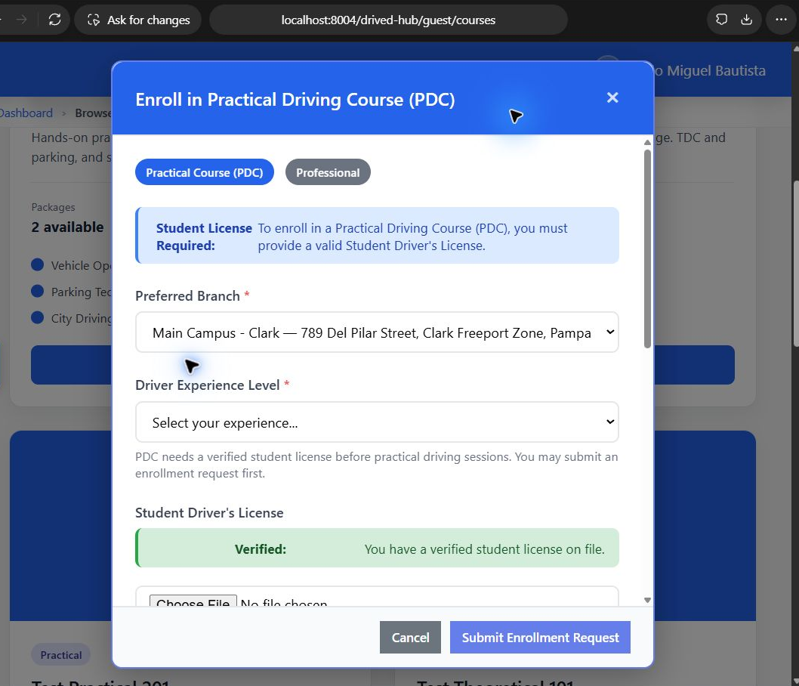 |
| Branch-specific schedule and instructors | 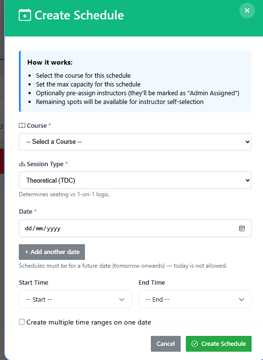 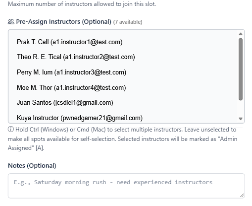 | 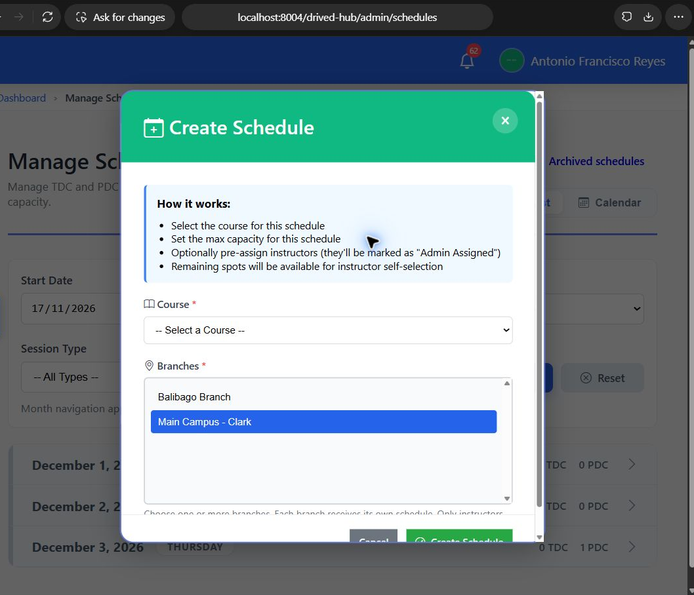 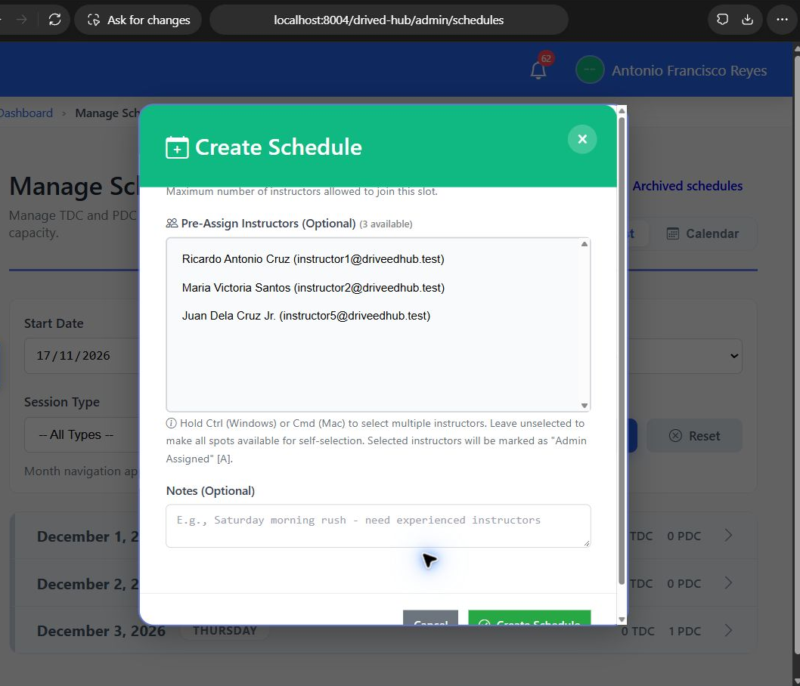 |
| Misleading enrolled badge | 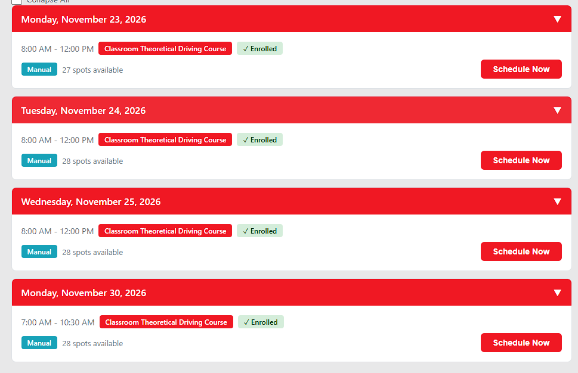 | 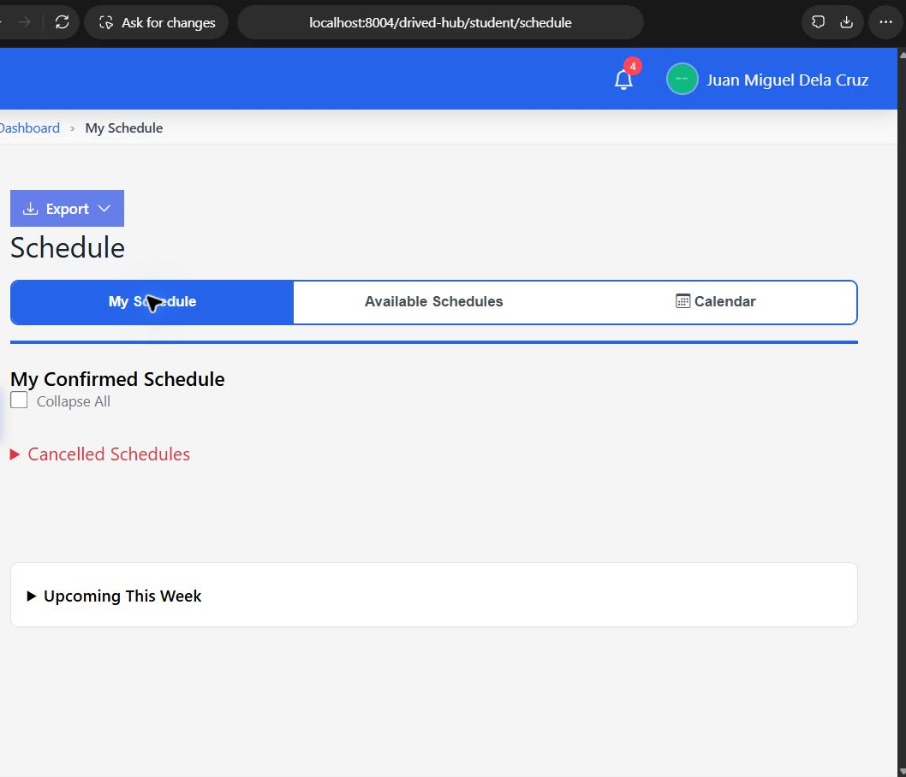 |

## Browser verification

- Registration: each policy’s acceptance action remained unavailable until its own content was scrolled to the bottom. After both policies were read, the two consent checkboxes were enabled and remained unchecked; no account was created.
- Instructor sessions: searching for `Miguel Francisco Ramos` returned two matching session rows. The filtered view showed type/date filters and the batch-grade controls.
- Branch assignment: the course-enrollment form exposed a preferred-branch selector. The schedule form allowed branch selection, and selecting Main Campus - Clark left three instructors available for assignment.
- Student schedule: the demo student used for the capture had no confirmed schedule slots. The screenshot documents the updated schedule view; the removed badge is also covered by the source regression check.

The Node regression checks passed: `node --test tests/verify-after-defense-findings.mjs tests/verify-nov15-findings.mjs` (**8 tests**). `git diff --check` also passed. PHP/Docker integration tests were unavailable in this environment.
