# November 14 findings

The `before` directory contains the original screenshots extracted from the supplied findings report. The `after` directory contains screenshots of the updated local application. No archive or rejection action was submitted while taking these screenshots.

## Before and after

| Finding | Before | After |
| --- | --- | --- |
| Schedule archives and restore access | [Schedule archive prompt](before/image1.png), [archived schedule list](before/image2.png) | [Archive confirmation](after/schedule-archive-confirmation.png), [archived schedules view](after/archived-schedules.png) |
| Multiple time ranges and duplicate schedules | [Reported time controls](before/image7.png), [duplicate schedule](before/image8.png) | [Working ranges from 6 AM to 6 PM](after/schedule-multiple-ranges.png) |
| Enrollment archive placement and active-record protection | [Enrollment page](before/image3.png), [archive confirmation](before/image9.png), [restore confirmation](before/image10.png) | [Archive control placement](after/enrollment-archive-controls.png), [styled archive modal](after/enrollment-archive-modal.png) |
| Full rejection versus selective rejection | [Checklist leaving the request pending](before/image5.png), [partial-rejection result](before/image6.png) | [Explicit full-rejection action](after/full-rejection-modal.png) |
| Payment archive and restore modals | [Archive prompt](before/image11.png), [restore prompt](before/image12.png) | [Styled payment archive modal](after/payment-archive-modal.png) |
| Vehicle and branch archive actions | [Vehicle delete actions](before/image13.png), [branch delete actions](before/image14.png) | [Vehicle archive controls](after/vehicle-archive-controls.png), [branch archive controls](after/branch-archive-controls.png) |
| Instructor logged sessions in My Progress | [Progress page without sessions](before/image15.png), [session details](before/image16.png), [schedule verification](before/image17.png), [verified session](before/image18.png) | [Progress totals and verified session history](after/student-progress-session-history.png) |

## Screenshot gallery

The images below are embedded so the changes can be reviewed directly in this document. Select an image to open its full-size version.

### Schedule archive and time ranges

| Before | After |
| --- | --- |
| [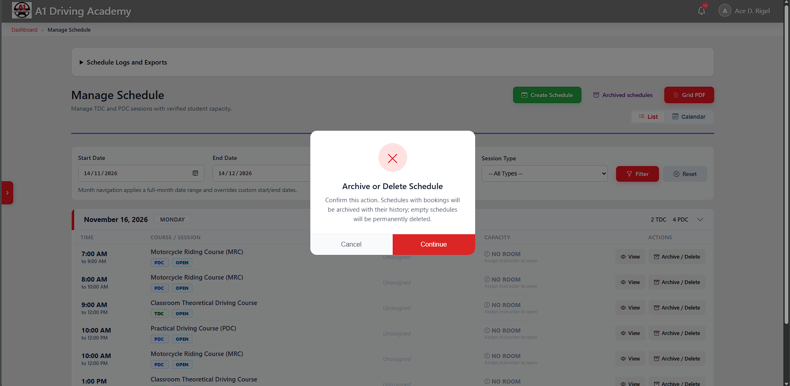](before/image1.png) | [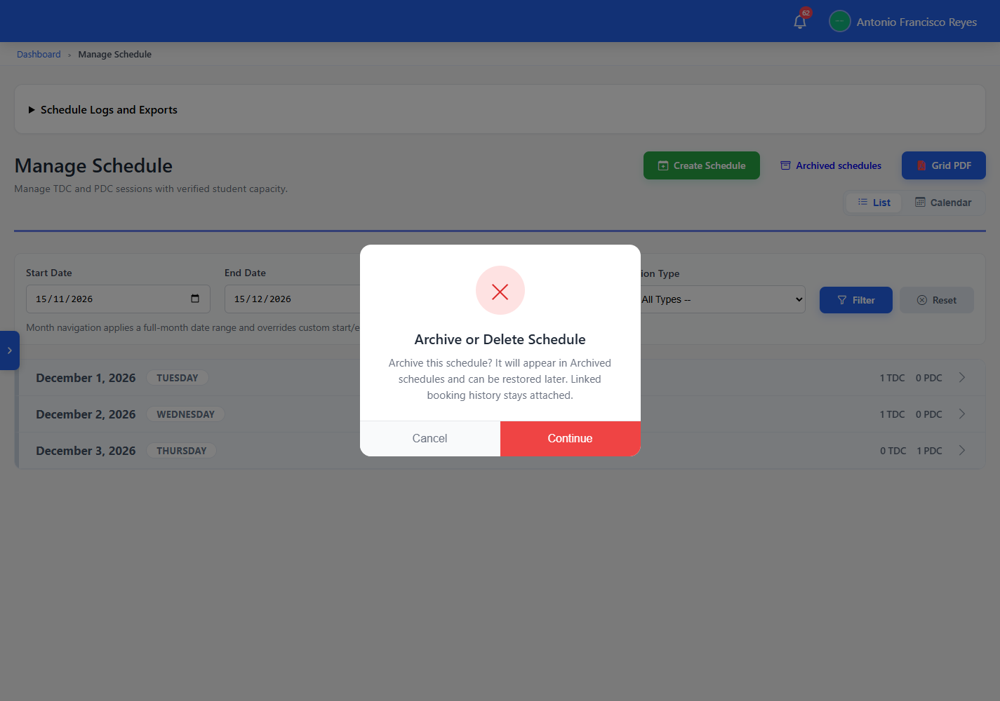](after/schedule-archive-confirmation.png) |
| [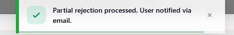](before/image7.png) | [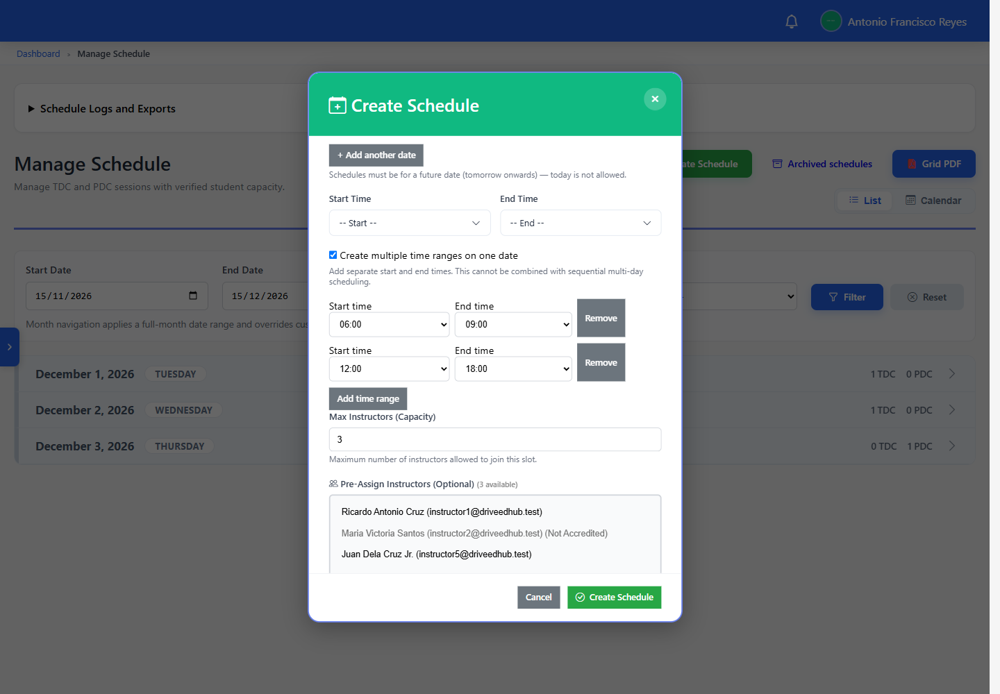](after/schedule-multiple-ranges.png) |

### Enrollment rejection and archive controls

| Before | After |
| --- | --- |
| [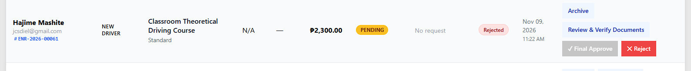](before/image5.png) | [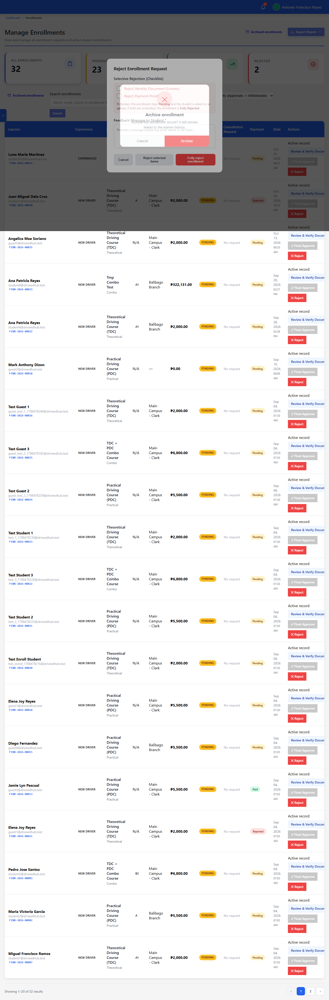](after/full-rejection-modal.png) |
| [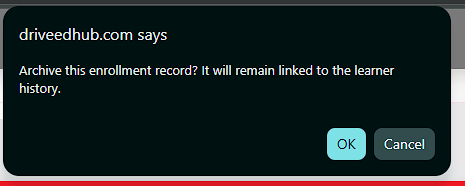](before/image9.png) | [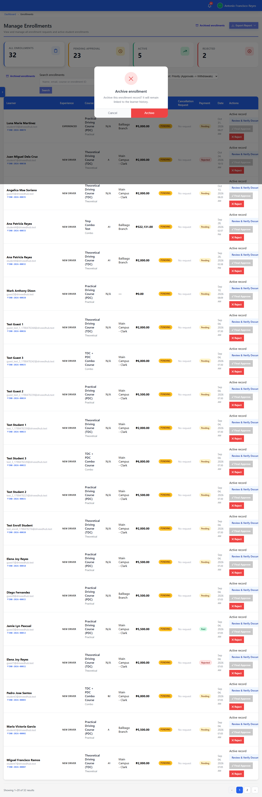](after/enrollment-archive-modal.png) |

### Payment, vehicle, and branch archive controls

| Before | After |
| --- | --- |
| [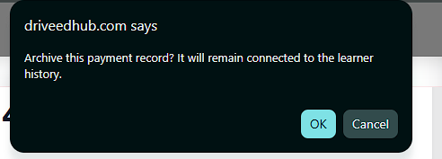](before/image11.png) | [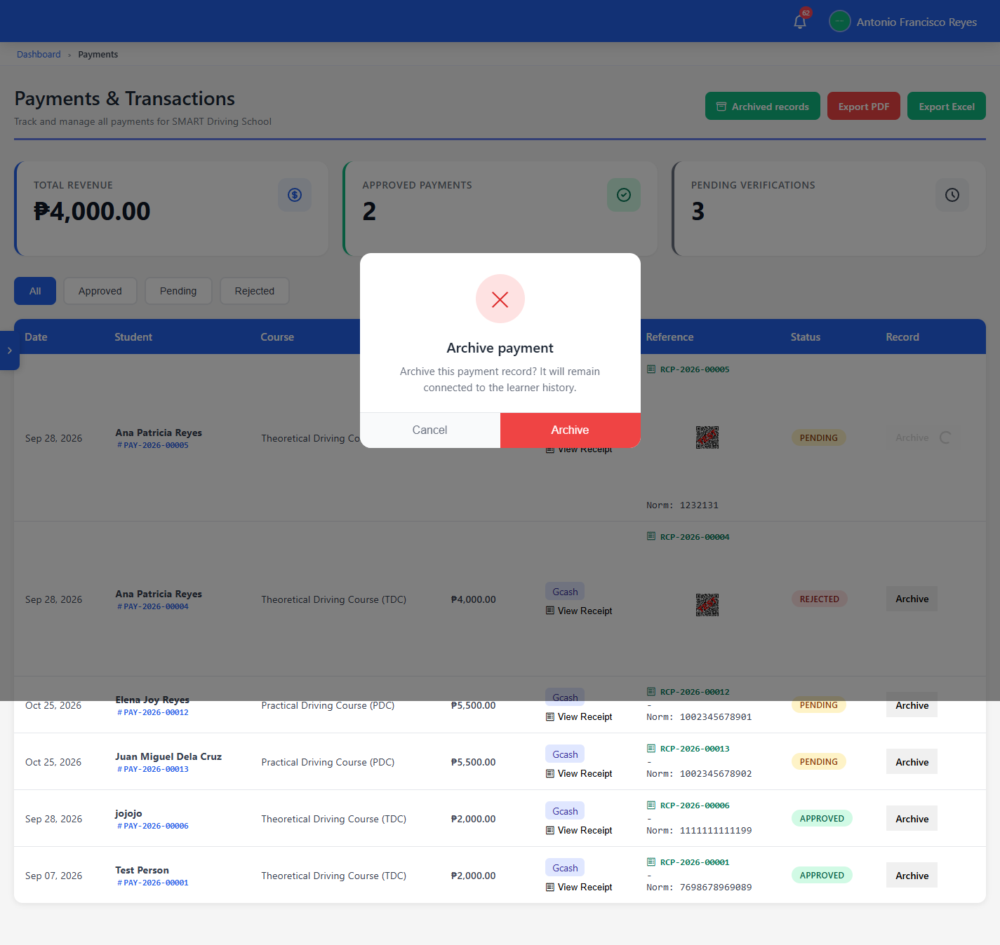](after/payment-archive-modal.png) |
| [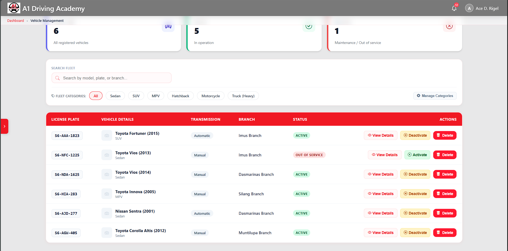](before/image13.png) | [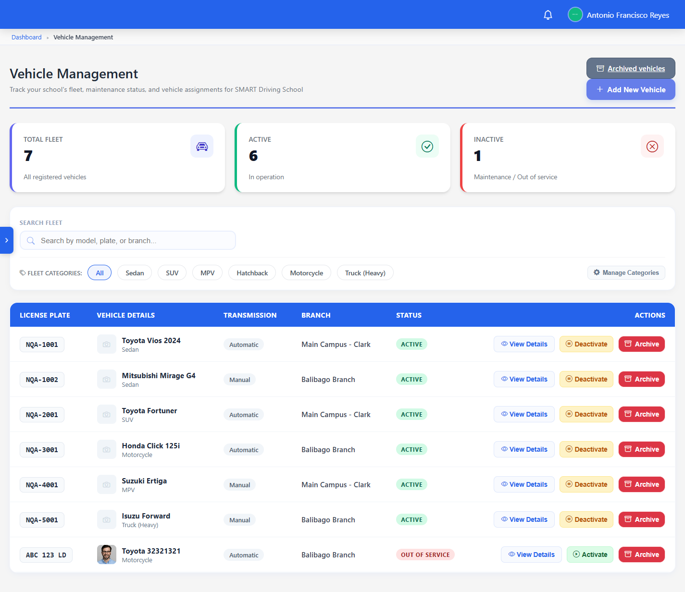](after/vehicle-archive-controls.png) |
| [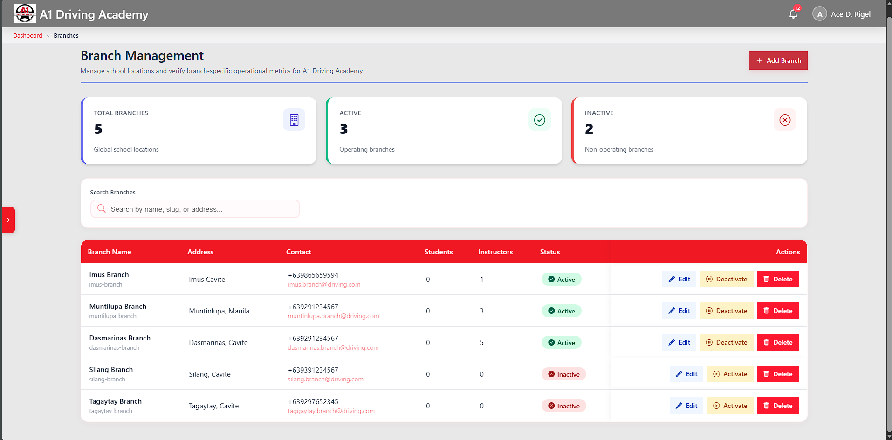](before/image14.png) | [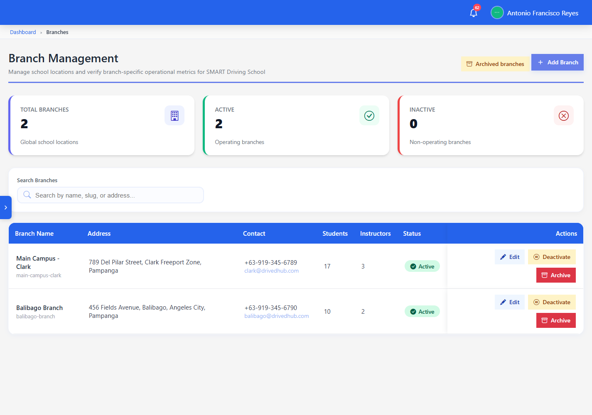](after/branch-archive-controls.png) |

### Instructor session history

| Before | After |
| --- | --- |
| [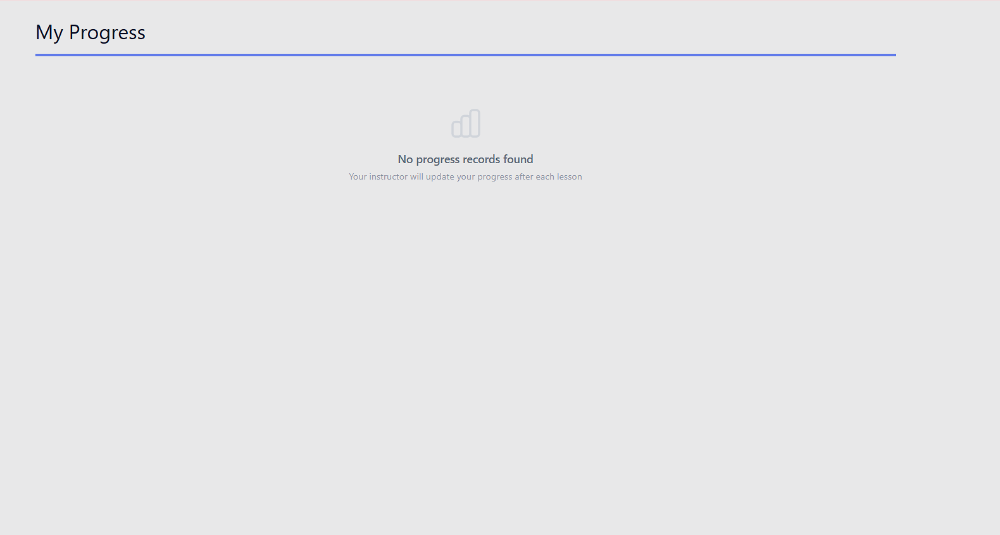](before/image15.png) | [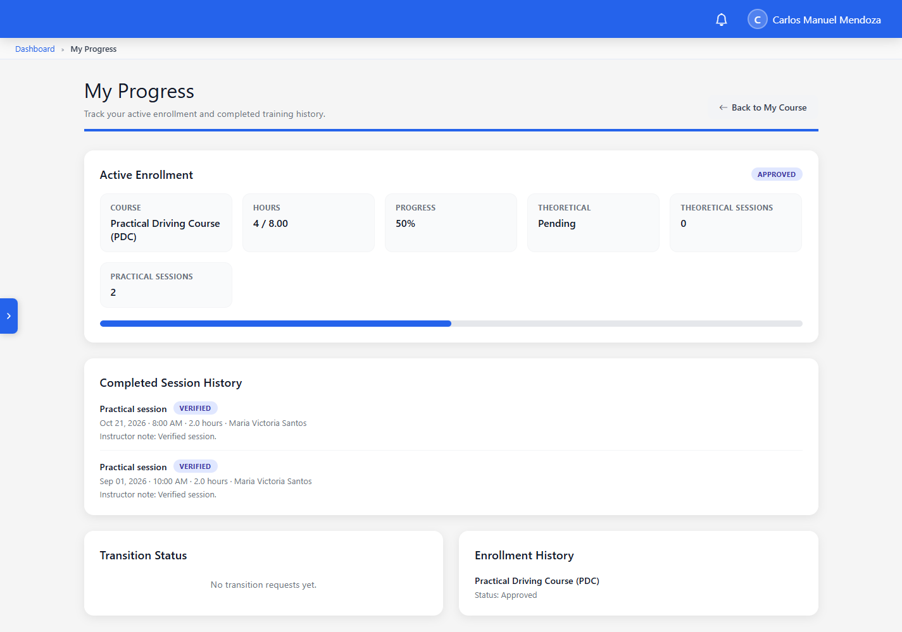](after/student-progress-session-history.png) |

## Screenshot capture

Regenerate the local after screenshots with `node tests/capture-nov14-after.mjs`. The capture script uses the local development accounts already referenced by the project’s local browser workflows and does not submit form actions.
