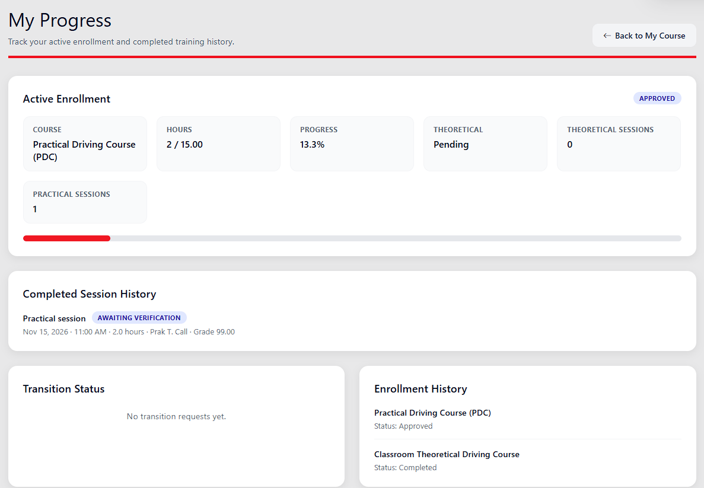
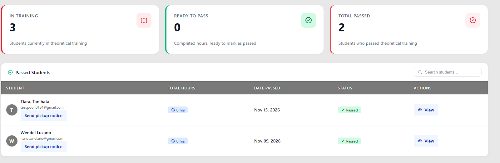
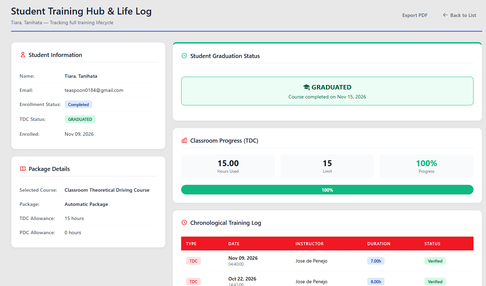
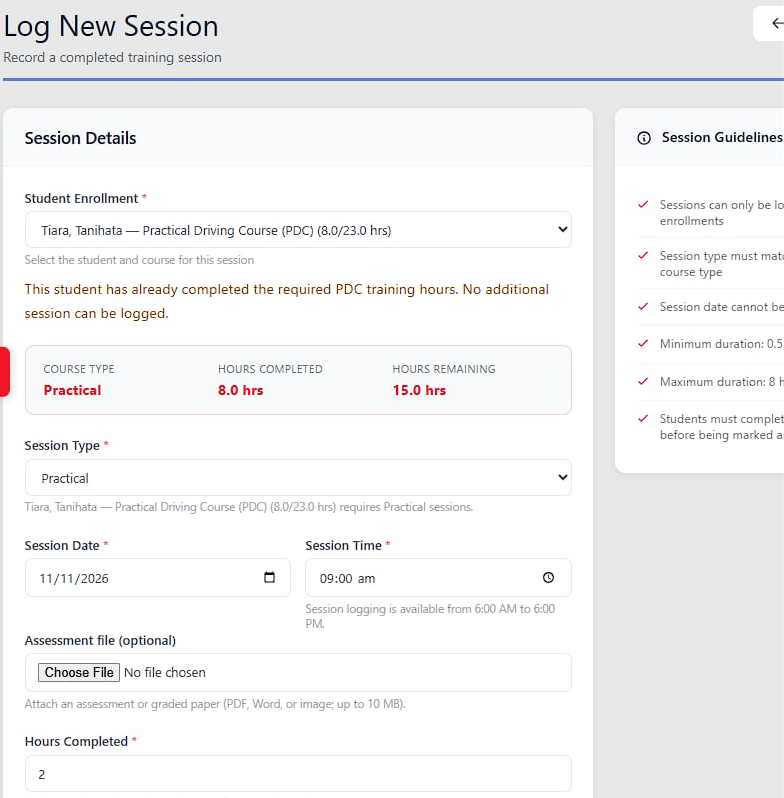
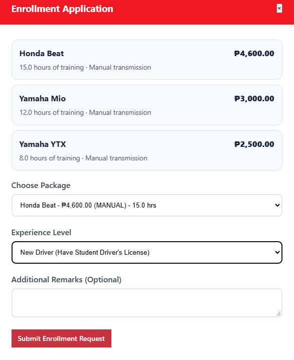

# November 15 findings screenshots

The `before` images below are the five screenshots embedded in the supplied findings document. The updated Student Training List was also opened in the local app after the changes; the live page showed both TDC and PDC enrollments with phase-specific hours. The instructor session form now reports progress for the selected phase and uses the PDC course requirement when the package has no explicit PDC allowance.

| Finding | Before |
| --- | --- |
| Student progress and enrollment history reference |  |
| Admin training list omitted graduated students and PDC |  |
| TDC graduation record |  |
| PDC session form marked complete with 15 hours remaining |  |
| PDC enrollment form omitted the student permit field |  |
